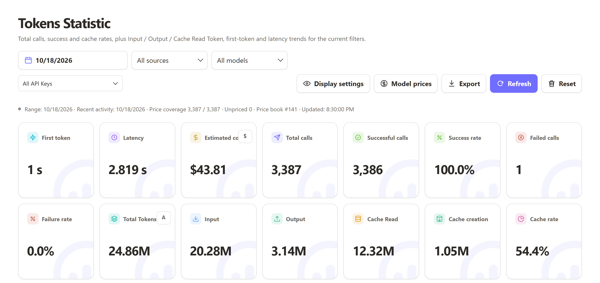

<p align="center"></p>
<h1 align="center">Tokens Statistic</h1>
<p align="center"><a href="README.md">简体中文</a> | English</p>
<p align="center">
  <a href="LICENSE"></a>
  <a href="https://github.com/Pet-Max/cpa-plugin-tokens-statistic/releases/latest"></a>
  <a href="https://go.dev"></a>
  <a href="https://github.com/Pet-Max/cpa-plugin-tokens-statistic/releases/latest"></a>
</p>

Tokens Statistic is a usage-statistics plugin for [CLIProxyAPI](https://github.com/router-for-me/CLIProxyAPI). Once installed, the Management Center gains a "Tokens Statistic" page: every model call is recorded with its model, token counts, latency, outcome and cache hits, presented as trend charts and detail tables for any time range. All data stays in a local database — nothing is uploaded.

<p align="center"></p>
<p align="center">📸 <a href="preview.md#english">Preview</a> (Metric cards · Service health · Tokens analysis · Request details · Model details · Pricing & sync)</p>

## Features

- Per-call records: model, input / output / reasoning / cache tokens, latency, TTFT, TPS, success rate and cache hits
- Multi-dimensional grouping: model, provider, executor, source, auth type, service tier, reasoning effort, failure status
- Summary cards, trend charts, dimension tables and per-request detail
- Time ranges: today, last 5 hours / 7 days / 30 days, current month, custom
- Trend aggregation from minute to month, wheel zoom and pan
- Table pagination, sorting and column preferences, token unit and currency toggles all persisted
- Filter by multiple API keys (union) and key labels
- Follows the Management Center theme and browser language; Simplified Chinese, Traditional Chinese, English and Russian built in
- Single-file plugin for Linux, Mac and Windows

## Deployment

**Method 1 (recommended)**: one-click install from the CPA plugin store inside the Management Center.

**Method 2**:

1. Download the zip for your platform from [Releases](https://github.com/Pet-Max/cpa-plugin-tokens-statistic/releases) and extract the dynamic library.
2. Place the library under `plugins/<os>/<arch>/` in your CLIProxyAPI directory.
3. Configure it in CLIProxyAPI's config.yaml (`enabled` is required — the host does not load plugins that are not explicitly enabled):

```yaml
plugins:
  enabled: true
  configs:
    tokens-statistic:
      enabled: true
      db: data/tokens-statistic.db   # database path, default <CLIProxyAPI dir>/data/tokens-statistic.db
      retention: 365                 # days to keep aggregates and request details (1–3650), default 365
      flush: 5s                      # batch write interval (1s–1h); omit the line to commit per record
      secret: "123456"               # API-key encryption key; use a random value of at least 32 bytes in production
      # health_warn: 95              # degraded threshold, default 95
      # health_crit: 80              # error threshold, default 80
```

4. Field reference:

| Field | Default | Description |
|---|---|---|
| `db` | `<CLIProxyAPI dir>/data/tokens-statistic.db` | bbolt database path. Empty uses the default location; relative paths resolve against the CLIProxyAPI working directory |
| `retention` | `365` | Days to keep per-minute aggregates and request details (1–3650), cleaned up automatically |
| `flush` | empty | Empty commits every record immediately; set an interval for batch writes (1s–1h). 5s is recommended for small hosts or high-traffic setups; bursts are absorbed by the internal 100-record batch cap |
| `secret` | `123456` | API-key encryption and fingerprint key; custom values need at least 32 bytes. Must be changed for public deployments; empty disables API-key tracking |
| `health_warn` / `health_crit` | `95` / `80` | Service-health success-rate thresholds: success rate below health_warn turns yellow (degraded), below health_crit turns red (error). Both 0–100 and health_warn must be greater than health_crit |

## Build

Local builds run the scripts in `scripts/` (4 platforms, artifacts stay in local `dist/` and are never committed). Releases are published by the repository maintainer: pushing a `v*` tag builds 6 platforms (including macOS) and creates a stable Release automatically. Requirements: Go 1.26+ and `CGO_ENABLED=1`; [zig](https://zig.dev) is the recommended cross compiler (MinGW-w64 works for Windows, aarch64-linux-gnu-gcc for Linux arm64).

| Platform | Command |
|---|---|
| Linux amd64 | `bash scripts/build-linux-amd64.sh` |
| Linux arm64 | `bash scripts/build-linux-arm64.sh` |
| Windows amd64 / arm64 | `powershell -ExecutionPolicy Bypass -File scripts/build_dll.ps1` |

- Artifacts: raw dynamic libraries land in `dist/`; store-conformant release packages (`tokens-statistic_<version>_<platform>.zip` + `checksums.txt`) land in `dist/release/v<version>/`, matching the assets CI publishes on releases; override the version with `VERSION`.
- Tests: `gofmt -w *.go && go vet ./... && go test -count=1 ./...`; optional browser regression tests need Node, Chrome/Edge and playwright-core (`npm ci`), plus `CHROME_PATH` pointing at the browser; they skip automatically when any of these is missing.

## Privacy and Security

- No prompts, request bodies or response bodies are stored — only the metadata and counters needed for statistics
- API keys are stored encrypted with keyed fingerprints; plaintext is served on demand only through management routes that require the CLIProxyAPI management key, never embedded in static page content, logs or browser storage
- Dashboard data and every management operation are protected by the CLIProxyAPI management key: opening the dashboard inside the Management Center reuses the signed-in identity automatically, while standalone access asks for the management key once (kept only for the current tab, invalidated as soon as it closes)
- The default `secret` (123456) is for local testing only; use a random value of at least 32 bytes for public deployments. Rotating `secret` preserves historical ciphertext but it can no longer be revealed, and leaving `secret` empty disables API-key tracking entirely

## Acknowledgements

[AITNR](https://github.com/AITNR/cap-token-usage-tracker)

## License

[MIT](LICENSE)
